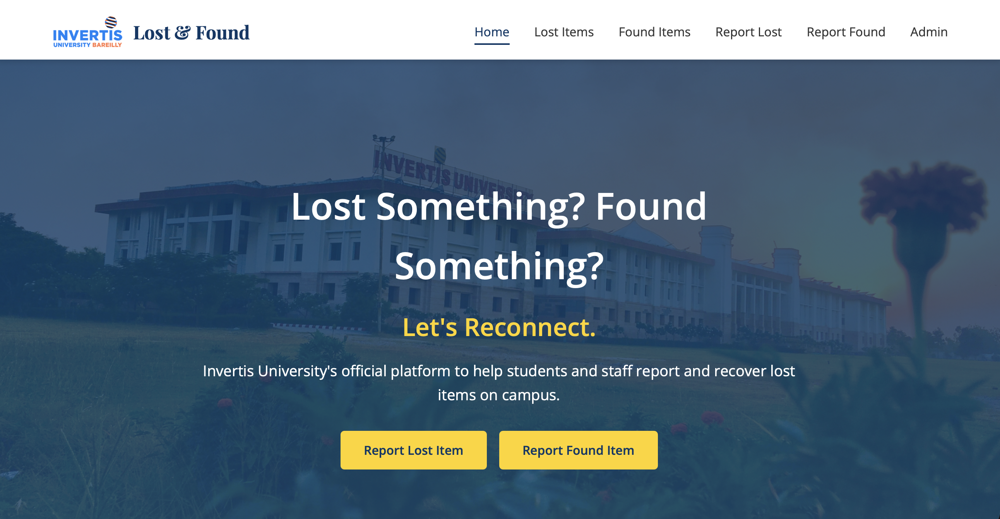
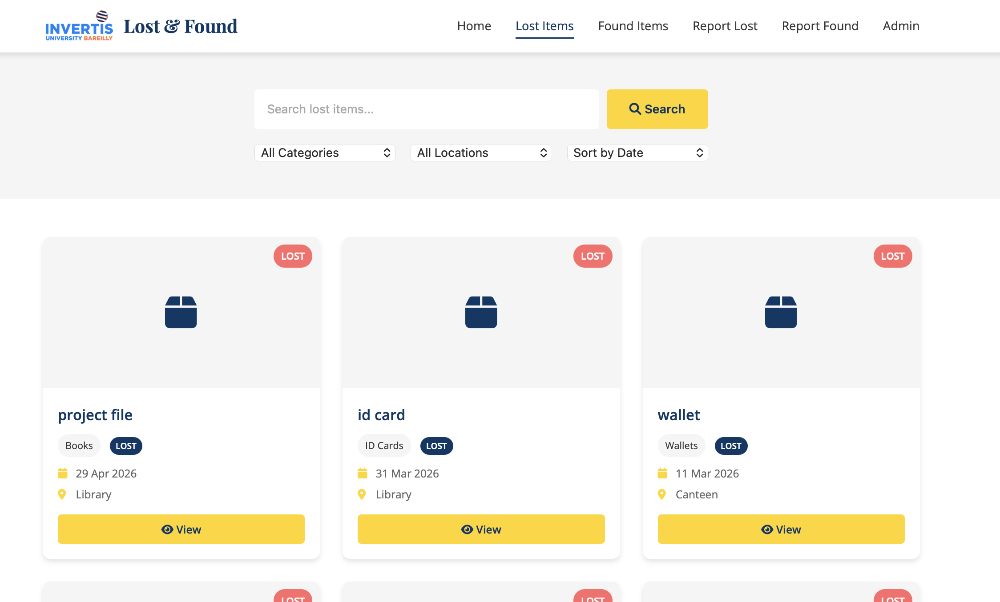
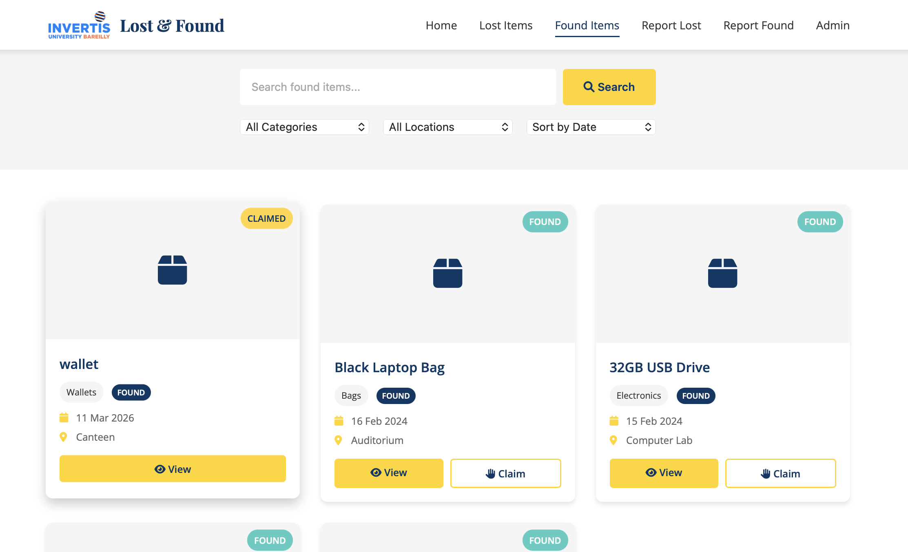
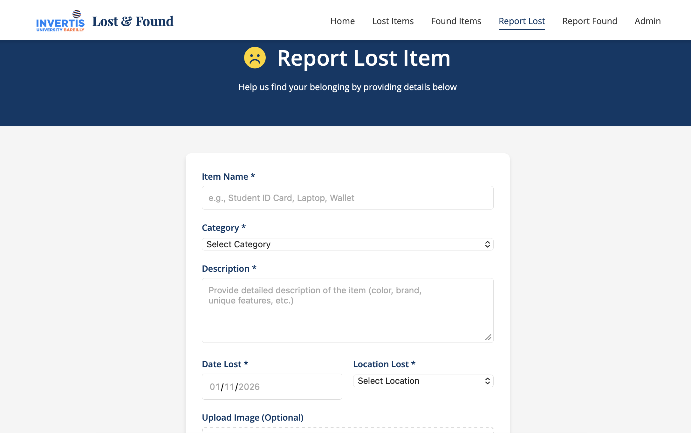
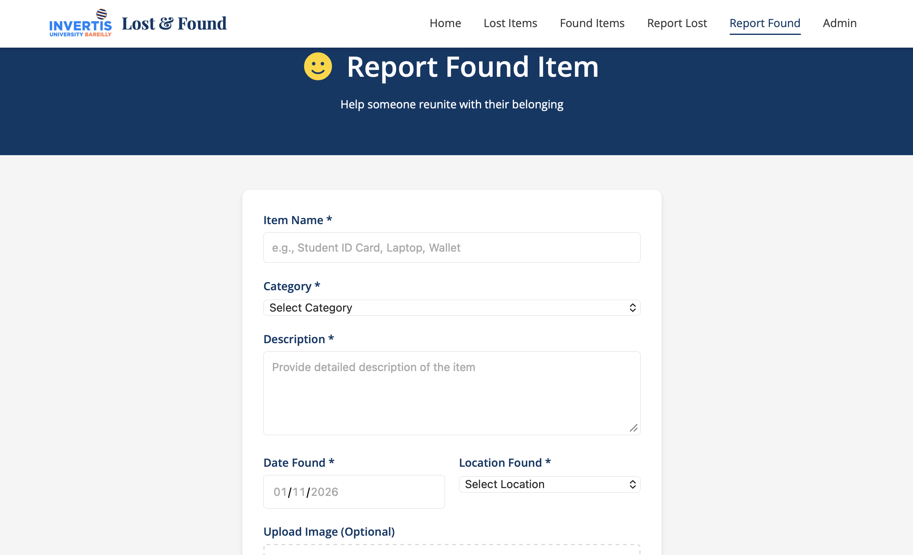
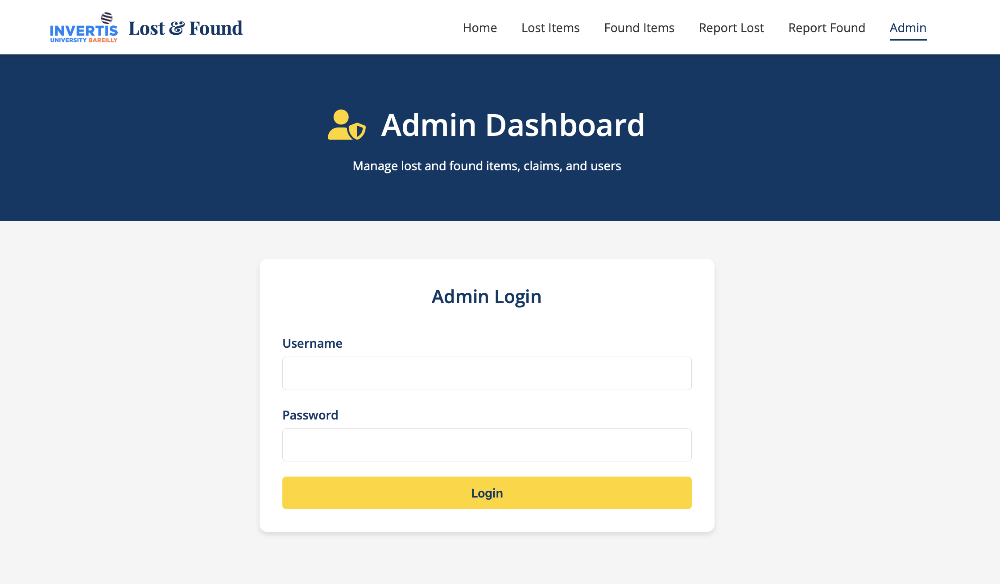
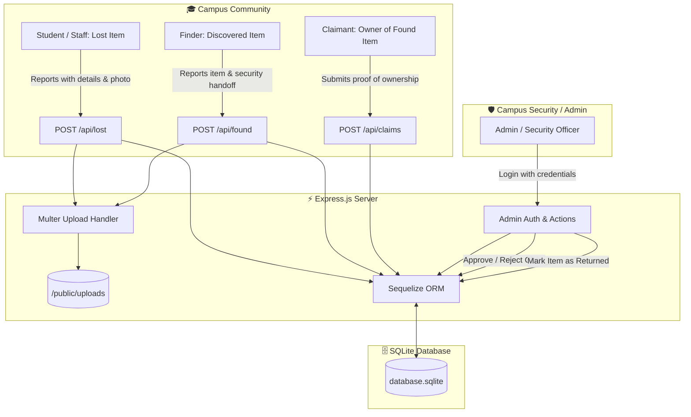

# 🎓 Invertis University — Lost & Found Portal

<p align="center">
  
</p>

<p align="center">
  <strong>A modern, full-stack campus asset recovery and management platform.</strong><br>
  Built for students, faculty, and campus security staff to report misplaced belongings, browse discovered items, submit ownership claims, and resolve asset recoveries.
</p>

<p align="center">
  <a href="#-core-features"></a>
  <a href="#️-tech-stack"></a>
  <a href="#️-tech-stack"></a>
  <a href="#️-tech-stack"></a>
  <a href="#️-tech-stack"></a>
  <a href="#-license"></a>
  <a href="https://github.com/s4hill/iu-lost-and-found-portal/pulls"></a>
</p>

---

## 📑 Table of Contents

- [📌 Overview](#-overview)
- [📸 Visual Preview & Screenshots](#-visual-preview--screenshots)
- [✨ Core Features](#-core-features)
- [🏗️ System Architecture & Workflow](#️-system-architecture--workflow)
- [🛠️ Tech Stack](#️-tech-stack)
- [🚀 Quick Start Guide](#-quick-start-guide)
  - [Prerequisites](#prerequisites)
  - [Installation & Setup](#installation--setup)
  - [Demo Admin Credentials](#demo-admin-credentials)
- [🌐 Application Pages](#-application-pages)
- [🔌 REST API Reference](#-rest-api-reference)
- [🗄️ Database Schema & Data Models](#️-database-schema--data-models)
- [📂 Project Directory Structure](#-project-directory-structure)
- [🔒 Security & Production Hardening](#-security--production-hardening)
- [🤝 Contributing](#-contributing)
- [📄 License](#-license)
- [👥 Authors & Acknowledgments](#-authors--acknowledgments)

---

## 📌 Overview

Misplacing student IDs, electronics, laptop chargers, keys, wallets, or textbooks across a large university campus is a frequent challenge. Traditional notice boards and fragmented social media groups are slow, noisy, and inefficient.

The **Invertis University Lost & Found Portal** solves this problem by providing a centralized, streamlined web application:
- **For Students & Faculty:** Instantly report lost belongings, browse or search items turned in by others, and file verified claims with proof of ownership.
- **For Campus Finders:** Easily log found items and specify whether they were deposited with campus security or retained personally.
- **For Administrative Staff & Security:** Review claims, verify ownership, approve or reject claims, toggle return statuses, and maintain transparency across campus asset recovery.

---

## 📸 Visual Preview & Screenshots

| 🏠 Home Dashboard & Live Metrics | 🔍 Lost Items Directory & Filters |
| :---: | :---: |
|  |  |
| *Live counters, recent reports, and quick report CTAs.* | *Search by keyword, filter by category and location.* |

| 📦 Found Items Directory | 📝 Report a Lost Item Form |
| :---: | :---: |
|  |  |
| *Browse items discovered across campus blocks with claim options.* | *Submit details, last known location, and optional photo.* |

| 🤝 Report a Found Item Form | 🛡️ Administrative Portal |
| :---: | :---: |
|  |  |
| *Log found items with finder contact and security handoff status.* | *Secure login to audit reports, verify claims, and mark items returned.* |

---

## ✨ Core Features

### 🔍 Parametric Search & Filtering
- **Keyword Search:** Instant full-text search across item names and detailed descriptions.
- **Campus Category Filters:** 9 distinct categories including *ID Cards, Mobile Phones, Wallets, Bags, Electronics, Books, Keys, Accessories, and Others*.
- **Campus Location Filters:** 10 pre-configured locations across Invertis University (*Library, Canteen, Auditorium, Computer Lab, Parking Lot, Sports Complex, Academic Block, Hostel, Administrative Block, Ground*).
- **Server-Side Pagination:** Smooth pagination (`page` and `limit`) for fast loading regardless of catalog size.

### 📸 Media Uploads & Form Validation
- **Image Attachments:** Optional image uploads handled by `Multer` with 5 MB file size limit and strict image MIME-type validation.
- **Input Sanitization:** Structured forms capturing date, exact location, and contact information (name, university email, phone).

### 🤝 Claim & Ownership Verification Workflow
- **Claim Submission:** Users can file a claim for any found item by submitting detailed proof of ownership (e.g., specific markings, serial numbers, wallpapers, contents).
- **Anti-Spam Guard:** Prevents duplicate concurrent pending claims on the same item.
- **Audit Trail:** Claims transition through `pending`, `approved`, and `rejected` statuses.

### 🛡️ Administrative Control Center
- **Session Authentication:** Protected administrator area powered by `express-session` and `bcryptjs`.
- **Status Management:** Mark lost or found items as `returned`, updating aggregate statistics in real time.
- **Claim Decisioning:** Approve valid claims (automatically setting item status to `claimed`) or reject invalid claims.
- **Record Management:** Permanently purge obsolete or duplicate listings.

### 📊 Real-Time Campus Analytics
- Dynamic statistics counter on the homepage showcasing:
  - Total Lost Items Reported
  - Total Found Items Discovered
  - Items Successfully Returned
  - Pending Claims in Review

### 📱 Responsive & Accessible UI
- Modern, clean user interface built with semantic HTML5 and vanilla CSS3.
- Fully responsive across desktop browsers, tablets, and mobile devices.
- Enhanced with Font Awesome 6 icons and intuitive status badges.

---

## 🏗️ System Architecture & Workflow



---

## 🛠️ Tech Stack

| Layer | Technology | Description |
| :--- | :--- | :--- |
| **Backend** | [Node.js](https://nodejs.org/) & [Express.js](https://expressjs.com/) | RESTful API server, routing, static asset serving, and middleware pipeline |
| **Database & ORM** | [SQLite3](https://www.sqlite.org/) via [Sequelize](https://sequelize.org/) | Embedded SQL database with schema synchronization and auto-seeding |
| **Frontend** | HTML5, CSS3, Vanilla JavaScript (ES6+) | Lightweight, dependency-free client application with responsive layouts |
| **File Handling** | [Multer](https://github.com/expressjs/multer) | Multipart form-data parser with disk storage, size limits, and MIME filtering |
| **Authentication** | [bcryptjs](https://github.com/dcodeIO/bcrypt.js) & [express-session](https://github.com/expressjs/session) | Secure password hashing and cookie-backed admin session management |
| **UI Assets** | [Font Awesome 6](https://fontawesome.com/) & Google Fonts | Vector iconography and modern typography |
| **Development** | [Nodemon](https://nodemon.io/) | Auto-reloading developer server |

---

## 🚀 Quick Start Guide

### Prerequisites

Ensure you have the following installed on your machine:
- **Node.js**: `v16.0.0` or higher ([Download Node.js](https://nodejs.org/))
- **npm**: `v8.0.0` or higher (bundled with Node.js)
- **Git**: ([Download Git](https://git-scm.com/))

### Installation & Setup

1. **Clone the repository:**
   ```bash
   git clone https://github.com/s4hill/iu-lost-and-found-portal.git
   cd iu-lost-and-found-portal
   ```

2. **Install project dependencies:**
   ```bash
   npm install
   ```

3. **Configure environment variables (optional):**
   Copy the provided `.env.example` file to create your local `.env`:
   ```bash
   cp .env.example .env
   ```

4. **Start the server:**
   
   - **Development mode** (auto-restarts on code changes using nodemon):
     ```bash
     npm run dev
     ```

   - **Production mode**:
     ```bash
     npm start
     ```

5. **Open in browser:**
   Navigate to [http://localhost:3000](http://localhost:3000).

> [!NOTE]
> On first startup, Sequelize automatically initializes `database.sqlite` in the project root and populates it with sample campus lost/found records and a default administrator account.

---

### Demo Admin Credentials

For testing the administrative dashboard locally, use the pre-seeded admin credentials:

| Field | Value |
| :--- | :--- |
| **Login URL** | `http://localhost:3000/admin` |
| **Username** | `admin` |
| **Password** | `admin123` |

> [!TIP]
> These credentials are for local development and demonstration purposes only. Refer to [Security & Production Hardening](#-security--production-hardening) before deploying to a production server.

---

## 🌐 Application Pages

| Route | File | Description |
| :--- | :--- | :--- |
| `/` | `public/index.html` | Homepage with hero section, live counters, recent reports, and quick links |
| `/lost` | `public/lost.html` | Searchable, filterable, and paginated directory of reported lost items |
| `/found` | `public/found.html` | Searchable directory of found items with direct links to submit ownership claims |
| `/report-lost` | `public/report-lost.html` | Form for reporting a lost item with date, location, contact, and image upload |
| `/report-found` | `public/report-found.html` | Form for reporting a found item with security handoff checkbox and photo |
| `/item` | `public/item.html` | Individual item detail view (`?id=<id>&type=<lost\|found>`) |
| `/claim` | `public/claim.html` | Formal ownership claim submission form (`?itemId=<id>&type=found`) |
| `/admin` | `public/admin.html` | Admin login and dashboard for managing reports, claims, and returned items |

---

## 🔌 REST API Reference

All API routes return JSON data.

### 📊 Campus Statistics

| Method | Endpoint | Description |
| :--- | :--- | :--- |
| `GET` | `/api/stats` | Returns counts for lost items, found items, returned items, and pending claims |

### 🔍 Lost Items

| Method | Endpoint | Params / Payload | Description |
| :--- | :--- | :--- | :--- |
| `GET` | `/api/lost` | `?limit=4` (optional) | List lost items ordered by creation date (descending) |
| `GET` | `/api/lost/search` | `?q=&category=&location=&page=1&limit=9` | Full-text search and filter with pagination |
| `GET` | `/api/lost/:id` | `id` (path) | Fetch single lost item details |
| `POST` | `/api/lost` | `multipart/form-data` (`item_name`, `category`, `description`, `date_lost`, `location_lost`, `contact_name`, `contact_email`, `contact_phone`, `image`) | Create a new lost item report |
| `PUT` | `/api/lost/:id/return` | `id` (path) | Mark a lost item as returned |
| `DELETE` | `/api/lost/:id` | `id` (path) | Delete a lost item report |

### 📦 Found Items

| Method | Endpoint | Params / Payload | Description |
| :--- | :--- | :--- | :--- |
| `GET` | `/api/found` | `?limit=4` (optional) | List found items ordered by creation date (descending) |
| `GET` | `/api/found/search` | `?q=&category=&location=&page=1&limit=9` | Full-text search and filter with pagination |
| `GET` | `/api/found/:id` | `id` (path) | Fetch single found item details |
| `POST` | `/api/found` | `multipart/form-data` (`item_name`, `category`, `description`, `date_found`, `location_found`, `finder_name`, `finder_email`, `finder_phone`, `handed_to_security`, `image`) | Create a new found item report |
| `PUT` | `/api/found/:id/return` | `id` (path) | Mark a found item as returned |
| `DELETE` | `/api/found/:id` | `id` (path) | Delete a found item report |

### 🤝 Claims

| Method | Endpoint | Params / Payload | Description |
| :--- | :--- | :--- | :--- |
| `GET` | `/api/claims` | None | Retrieve all claims ordered by newest first |
| `POST` | `/api/claims` | `application/json` (`item_id`, `item_type`, `claimant_name`, `claimant_email`, `claimant_phone`, `proof_description`) | Submit an ownership claim for an item |
| `PUT` | `/api/claims/:id/approve` | `id` (path) | Approve a claim (marks item as `claimed`) |
| `PUT` | `/api/claims/:id/reject` | `id` (path) | Reject a claim |

### 🛡️ Admin Authentication

| Method | Endpoint | Params / Payload | Description |
| :--- | :--- | :--- | :--- |
| `POST` | `/api/admin/login` | `application/json` (`username`, `password`) | Authenticate admin credentials and start session |
| `POST` | `/api/admin/logout` | None | Destroy active admin session |
| `GET` | `/api/admin/check` | None | Check if current session has active admin privileges |

---

## 🗄️ Database Schema & Data Models

The SQLite database is managed via Sequelize ORM with timestamps enabled (`created_at`, `updated_at`).

```
┌─────────────────────────┐         ┌─────────────────────────┐
│        LostItem         │         │        FoundItem        │
├─────────────────────────┤         ├─────────────────────────┤
│ id (PK)                 │         │ id (PK)                 │
│ item_name: STRING       │         │ item_name: STRING       │
│ category: STRING        │         │ category: STRING        │
│ description: TEXT       │         │ description: TEXT       │
│ date_lost: DATEONLY     │         │ date_found: DATEONLY    │
│ location_lost: STRING   │         │ location_found: STRING  │
│ image_path: STRING      │         │ image_path: STRING      │
│ contact_name: STRING    │         │ finder_name: STRING     │
│ contact_email: STRING   │         │ finder_email: STRING    │
│ contact_phone: STRING   │         │ finder_phone: STRING    │
│ status: ENUM            │         │ handed_to_security: BOOL│
│   ['lost', 'claimed',   │         │ status: ENUM            │
│    'returned']          │         │   ['found', 'claimed',  │
└─────────────────────────┘         │    'returned']          │
                                    └─────────────────────────┘
                 ▲                               ▲
                 │                               │
                 └──────────────┬────────────────┘
                                │
                    ┌─────────────────────────┐
                    │          Claim          │
                    ├─────────────────────────┤
                    │ id (PK)                 │
                    │ item_id: INTEGER        │
                    │ item_type: ENUM         │
                    │   ['lost', 'found']     │
                    │ claimant_name: STRING   │
                    │ claimant_email: STRING  │
                    │ claimant_phone: STRING  │
                    │ proof_description: TEXT │
                    │ status: ENUM            │
                    │   ['pending', 'approved'│
                    │    'rejected']          │
                    └─────────────────────────┘
```

---

## 📂 Project Directory Structure

```text
iu-lost-and-found-portal/
├── .env.example             # Template for environment configuration
├── .gitignore               # Git ignore rules for node_modules, sqlite, uploads
├── README.md                # Project documentation and guide
├── package.json             # Project dependencies and npm scripts
├── package-lock.json        # Pinned dependency tree
├── server.js                # Core Express application and REST API endpoints
├── database.sqlite          # SQLite database (auto-generated on first run)
│
├── models/                  # Sequelize ORM schema definitions
│   ├── Admin.js             # Admin user schema
│   ├── Claim.js             # Ownership claim schema
│   ├── FoundItem.js         # Discovered item schema
│   ├── LostItem.js          # Lost item schema
│   └── index.js             # Sequelize connection, sync, and seed logic
│
├── routes/                  # Express route modules
│   ├── claimRoutes.js       # Claim endpoints
│   ├── foundRoutes.js       # Found items endpoints
│   └── lostRoutes.js        # Lost items endpoints
│
├── public/                  # Static frontend assets
│   ├── 404.html             # Custom 404 error page
│   ├── admin.html           # Admin dashboard and login interface
│   ├── claim.html           # Ownership claim submission form
│   ├── found.html           # Found items directory
│   ├── index.html           # Portal landing page and live counters
│   ├── item.html            # Individual item detail page
│   ├── lost.html            # Lost items directory
│   ├── report-found.html    # Form to report found items
│   ├── report-lost.html     # Form to report lost items
│   ├── css/
│   │   └── style.css        # Global CSS styling and responsive layouts
│   ├── images/
│   │   ├── college-bg.jpg   # Campus hero background banner
│   │   ├── favicon.ico      # Site favicon
│   │   └── logo.png         # Invertis University logo
│   ├── js/
│   │   ├── admin.js         # Admin dashboard logic and tab management
│   │   ├── main.js          # General page scripts and animations
│   │   └── search.js        # Search, filter, and pagination controller
│   └── uploads/             # Destination for user-uploaded item photos
│       └── .gitkeep         # Directory placeholder
│
└── screenshots/             # High-resolution screenshots for README
    ├── admin-login.png      # Admin console preview
    ├── found-items.png      # Found items listing preview
    ├── home-page.png        # Homepage preview
    ├── lost-items.png       # Lost items listing preview
    ├── report-found.png     # Report found item preview
    └── report-lost.png      # Report lost item preview
```

---

## 🔒 Security & Production Hardening

Before deploying this application to a public or production environment, ensure the following measures are taken:

1. **Rotate Session Secret:** Replace the static secret in `server.js` with `process.env.SESSION_SECRET`.
2. **Secure Cookies:** In production (`process.env.NODE_ENV === 'production'`), enable `cookie.secure: true` (requires HTTPS) and `cookie.httpOnly: true`.
3. **Change Admin Credentials:** Never use the default `admin` / `admin123` password in production. Change it through the database or provide an environment-driven password.
4. **Database Migration:** For high-traffic campus deployments, switch the Sequelize dialect from `sqlite` to `postgres` or `mysql2` (already installed in dependencies).
5. **Rate Limiting:** Implement `express-rate-limit` on submission routes (`/api/lost`, `/api/found`, `/api/claims`, `/api/admin/login`) to guard against brute-force attacks and spam.
6. **Data Privacy:** Regularly review `public/uploads/` and user submissions to ensure compliance with institutional privacy policies.

---

## 🤝 Contributing

Contributions, feature requests, and improvements are warmly welcome!

1. **Fork the Project**
2. **Create your Feature Branch** (`git checkout -b feature/NewFeature`)
3. **Commit your Changes** (`git commit -m 'feat: Add NewFeature'`)
4. **Push to the Branch** (`git push origin feature/NewFeature`)
5. **Open a Pull Request**

---

## 📄 License

This project is licensed under the **MIT License** — see the [LICENSE](LICENSE) file for details.

---

## 👥 Authors & Acknowledgments

- **Developed by:** [Sahil (@s4hill)](https://github.com/s4hill)
- **Institution:** Invertis University
- **Special Thanks:** Campus community, security personnel, and student contributors who helped test and refine the workflow.

<p align="center">
  Made with ❤️ for <strong>Invertis University</strong>
</p>
